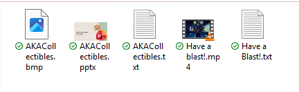
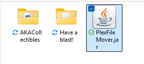
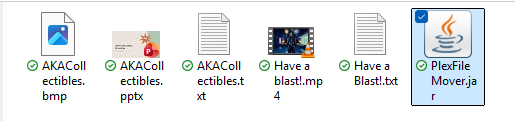
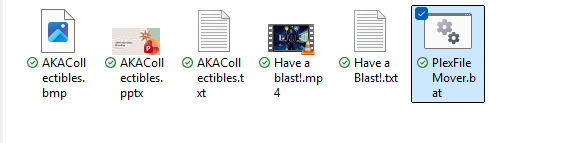

# PlexFileMover

**This project is currently under development, and it will soon be open to other collaborators. Please stay tuned!**

---

## Purpose

If you own a Plex media server, you may be familiar with just how messy it can all get. One movie alone can have several files attached to it, from different versions and languages, to subtitles and other notes. As such, your server may be unorganized and difficult to go through:



Within the media server community, it is common to organize files into folders to distinguish different movies and shows, but this can take a long time for a whole server with hundreds, if not *thousands* of files if you do it by hand, or even if you tried some AI prompt that isn't guaranteed to yield the results you expect.

Luckily for us, PlexFileMover is *back!* And, it is easier than ever to use it. **No coding knowledge is required!** All you have to do is drag the executable into your server's directory, and *click on it!* Everything is instantly moved into folders that match the file names. And don't worry; PlexFileMover won't be affected, so you can keep it in your server for multiple usages as your server grows.



---

## Installation

### <u>Java</u>

Java is the best option for **universal OS compatibility.** It is able to run on Windows, Mac, Linux, and Solaris. You will need Java installed first, but you can find and install the latest version for your device [here](https://www.java.com/en/download/manual.jsp).

After Java is successfully installed, you should be able to run `.jar` files on your computer. Download the latest `.jar` file from this repository's **Releases** page, and put it directly into your media server's directory. From there, you may click on it anytime your server needs a little makeover 💅.



This project is open-source, so you may view the raw `.java` code anytime in the **src** folder of this repository and know exactly what it does.

### <u>Shell Script</u>

**Shell scripting is native to Linux-run operating systems.** Since Mac is built on Unix technology, shell scripts will run on it with no required downloads. If you have Windows, you must have a separate Linux build, or simply the latest version of <u>Git</u>, which you can get [here](https://git-scm.com/install/windows).

The process may differ depending on your OS. I'm able to click on the file and run it in Windows, but it's also common to run shell scripts in the terminal. After putting the script in your server's directory, open the terminal in the same place:

```
# 1. Make the file executable
chmod +x PlexFileMover.sh

# 2. Run the script
./PlexFileMover.sh
```

And of course, you can view the code by editing the script or through the **software** folder on this repository.

### <u>Batch File</u>

**Batch files are native to Windows**, and they cannot be run on other operating systems. If you have Windows but no Java on your computer, the Batch file version is sufficient. No downloads are required to run `.bat` files on your computer, though it is not nearly as popular due to its old age and lack of trust overall.

The process remains the same: drag the file into your server's directory and click on it. Note that you'll see the command prompt quickly open and close, but no action is required on your part, and the same actions are carried out.



If in doubt, you may **right click and edit** the file to see the code, so you can know exactly what it does. Alternatively, you may easily view it in the **software** folder of this repository.

---

### Other Versions

Versions alternative to Java are still in the works, so that you may one day be able to use PlexFileMover regardless of OS and installed programs. Please stay tuned!
